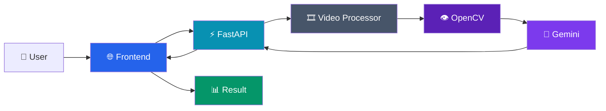
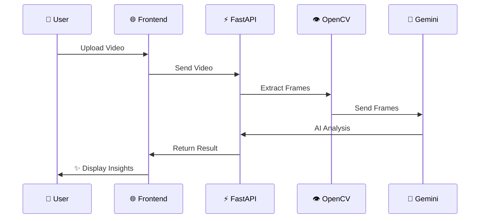

# 🎥 SnapTeller

### AI-Powered Video Understanding

**Upload a video → Extract frames → Gemini analyzes → Get insights**

 

---

## ✨ What is SnapTeller?

SnapTeller turns videos into **AI-generated visual insights** using OpenCV and Google Gemini.

Instead of watching the entire video, SnapTeller extracts important frames and lets AI understand what's happening.

---

## 🧠 How It Works

### ⚡ Core Pipeline

**Video → OpenCV → Selected Frames → Gemini → AI Analysis**

---

## 🏗️ Architecture

---

## 🚀 Features

| | Feature |
|---|---|
| 🎬 | Video upload & analysis |
| 🖼️ | Automatic frame extraction |
| 🤖 | Gemini-powered visual understanding |
| 📝 | AI-generated descriptions |
| ⚡ | Fast lightweight processing |
| 🌐 | Simple web interface |
| 🔐 | Environment-based API keys |

---

## 🛠️ Tech Stack

**Backend:** Python · FastAPI · Uvicorn

**AI / Vision:** Google Gemini · OpenCV · Pillow

**Frontend:** HTML · CSS · JavaScript

**Tools:** Git · GitHub · Python venv

---

## 📂 Project Structure

    snap-teller/
    ├── frontend/
    │   ├── index.html
    │   ├── script.js
    │   └── style.css
    ├── main.py
    ├── ai_analyzer.py
    ├── video_processor.py
    ├── test_ai.py
    ├── test_video.py
    └── README.md

---

## ⚙️ Quick Start

### 1. Clone

    git clone https://github.com/itsdivyanshuno/snap-teller.git
    cd snap-teller

### 2. Setup

    python3 -m venv venv
    source venv/bin/activate
    pip install fastapi uvicorn opencv-python google-genai python-multipart Pillow python-dotenv

### 3. Add Gemini API Key

Create `.env`:

    GEMINI_API_KEY=your_api_key_here

### 4. Run Backend

    uvicorn main:app --reload

**API:** `http://127.0.0.1:8000`

### 5. Run Frontend

    cd frontend
    python3 -m http.server 5500

**App:** `http://localhost:5500`

---

## 🔄 Request Flow

---

## 🔮 Roadmap

- 🎤 Audio & speech analysis
- ⏱️ Timestamp-based insights
- 📌 Automatic highlight detection
- 🧠 Better scene understanding
- 📊 Video analytics
- ☁️ Cloud processing
- 🔐 User authentication

---

## 👨‍💻 Author

**Divyansh Shukla**

B.Tech Information Technology — **HBTU Kanpur**

---

### 🎥 **SnapTeller**
**Watch less. Understand more.**

*Built with Python · OpenCV · FastAPI · Gemini AI*

